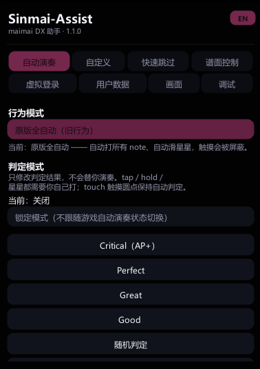
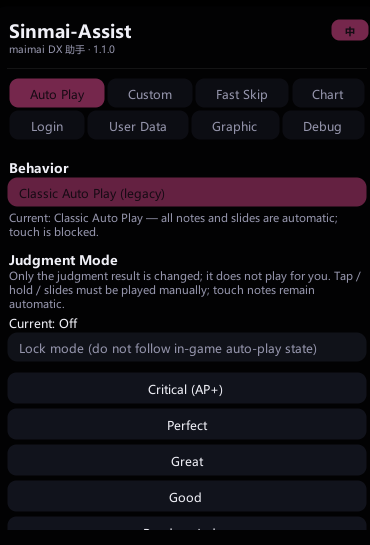
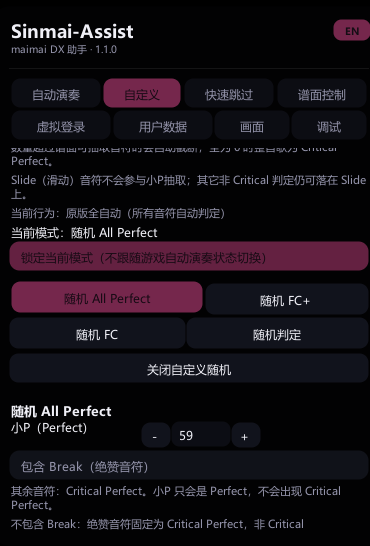
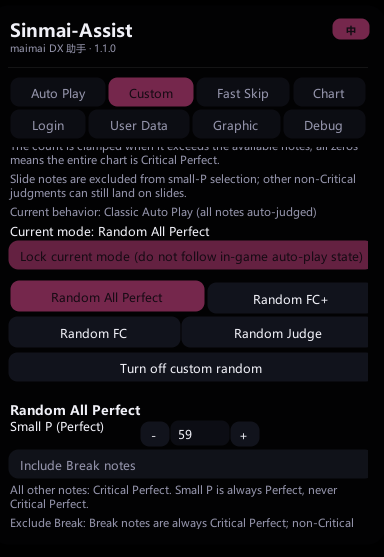

# Sinmai-Assist

[English](README.md) | [简体中文](README.zh-CN.md)

[](https://github.com/Ccmtv/Sinmai-Assist-Mod/releases)
[](#requirements)
[](https://github.com/LavaGang/MelonLoader)
[](#requirements)
[](#license)

A **MelonLoader** mod for SEGA's arcade rhythm game **maimai DX (Sinmai)** that adds a
**judgment-only autoplay** mode: you play the chart yourself, and every successful hit is
forced to the selected judgment (`Critical`, `Perfect`, `Great`, ...). It also adds a
**Custom Autoplay** page for exact-count random judgments and a **Chinese / English UI
switch**.

Unlike the original autoplay, it does **not** drive the game's own AutoPlay state, so touch
input keeps working and stars (slides) must be performed manually. If you want the old
"play the chart for me" behaviour, a single toggle restores it.

> Unofficial fan project. Not affiliated with SEGA. Use at your own risk; see
> [Disclaimer](#disclaimer).

<p align="center">
  <a href="docs/panel-zh-autoplay.png"></a>
  <a href="docs/panel-en-autoplay.png"></a>
</p>
<p align="center">
  <a href="docs/panel-zh-custom.png"></a>
  <a href="docs/panel-en-custom.png"></a>
</p>

---

## Features

- **Judgment-only mode (default)**: tap / hold / break are played by you, hits are forced
  to the selected judgment, missed notes still count as MISS
- **Stars are manual**: the slide follows your hand and is only judged when you complete it
- **Touch tap notes stay automatic**, so they do not get in the way of your slides
- **Classic full autoplay toggle**: one switch restores the original Sinmai-Assist
  behaviour (all notes auto-played, stars auto-slide, touch input blocked)
- **8 judgment modes** plus `None`
- **Custom Autoplay page**: exact counts of small Perfect (non-Critical), Great, Good and
  Miss for the random AP / FC+ / FC / Random modes, with an optional Break-note toggle
- **Slide notes never become small Perfect**; Great / Good / Miss each have their own
  **Include Slide** toggle, and BreakSlide requires both the Break and Slide toggles
- **Bilingual UI**: a top-right `EN / 中` button switches the whole panel between Chinese
  and English; the choice is saved
- **Dark UI**: rounded panels, pink / cyan accents, Microsoft YaHei, draggable, scrollable
- **Config persisted** to `Sinmai-Assist/Config.yml`
- Only `Sinmai-Assist.dll` is added; no game files are modified

---

## Requirements

| Item | Notes |
| --- | --- |
| **Game** | maimai DX `Sinmai.exe` (SDGB package). Tested on the current SDGB build; other versions may contain different method names/IL. |
| **Loader** | **MelonLoader 0.6.x, x64** |
| **Runtime** | The game's Unity Mono runtime; the mod targets **.NET Framework 4.7.2** |
| **OS** | Windows x64 |

This mod is a modified build of
[WYH2004-MC/Sinmai-Assist](https://github.com/WYH2004-MC/Sinmai-Assist) `1.0.0` (commit
`787a437`). Other mods in `Mods/` are not required.

---

## Installation

1. **Install MelonLoader 0.6.x** into the game root (the folder containing `Sinmai.exe`).

2. **Copy the mod**:

   ```text
   <game>/
   └── Mods/
       └── Sinmai-Assist.dll
   ```

3. **Launch the game** and check `MelonLoader/Latest.log`:

   ```text
   [Sinmai-Assist] Config Load Complete.
   [Sinmai-Assist] Loading completed
   ```

4. Press **`Backspace`** to show/hide the panel.

A ready-to-use build is attached to
[Releases](https://github.com/Ccmtv/Sinmai-Assist-Mod/releases).

---

## Usage

| Key | Action |
| --- | --- |
| `Backspace` | Show / hide the panel |
| `F` | `Critical` (AP+) mode |
| `O` | `Great` mode |
| `P` | `Good` mode |
| `K` | `Random` mode |
| `G` | `RandomAllPerfect` mode |
| `H` | `RandomFullComboPlus` mode |
| `J` | `RandomFullCombo` mode |
| `N` | `None` (disable) |

All keys can be changed in `Sinmai-Assist/KeyBindConfig.yml`.

At the top of the **自动演奏** panel there is a **原版全自动（旧行为）** switch:

- **ON** — classic full autoplay: every note is played for you, stars auto-slide, touch
  input is blocked
- **OFF** — judgment-only mode: you play, the mod only rewrites the judgment

The choice is saved to `cheat.classicAutoPlay` in `Sinmai-Assist/Config.yml`.

### Custom Autoplay page

Open the **自定义 / Custom** tab. It has four mode buttons and no fixed
`Critical / Perfect / Great / Good` buttons:

| Mode | Counts | Behaviour |
| --- | --- | --- |
| **Random All Perfect** | small Perfect | Exactly N non-Critical Perfect notes; the rest Critical Perfect |
| **Random FC+** | small Perfect + Great | The rest Critical Perfect |
| **Random FC** | small Perfect + Great + Good | The rest Critical Perfect |
| **Random Judge** | small Perfect + Great + Good + Miss | The rest Critical Perfect |

- Counts are **per song** and strictly generated from a precomputed random plan.
- Counts larger than the available notes are clamped; all zeros means the whole chart is
  Critical Perfect.
- **Include Break** ON: non-Critical judgments may land on Break notes. OFF: Break notes are
  always Critical Perfect.
- **Slide notes are excluded from small Perfect.** Great / Good / Miss each have an
  independent **Include Slide** toggle; when it is off that judgment cannot land on a slide.
- The star head and the slide body are both treated as **Slide**, so both become Critical
  Perfect when the matching Include Slide toggle is off.
- **BreakSlide** is available only when both **Include Break** and the matching
  **Include Slide** toggle are on.
- The page's mode selection is locked automatically so the game does not overwrite it.
- Settings are saved under `cheat.customAutoPlay` in `Sinmai-Assist/Config.yml`.

In **classic full autoplay** every note is hit automatically, so the counts are exact. In
**judgment-only** mode the plan only applies to notes you actually hit; missed notes are
still Miss, so the final counts can differ.

---

## Modes

| Mode | Behaviour | Typical result |
| --- | --- | --- |
| **Critical** | Every hit becomes `Critical` | AP+ |
| **Perfect** | Random `FastPerfect2nd` / `LatePerfect2nd` | AP |
| **Great** | Random `FastGreat` / `LateGreat` | Full Combo |
| **Good** | Random `FastGood` / `LateGood` | Full Combo |
| **Random** | Exact-count plan: small Perfect / Great / Good / Miss, rest Critical Perfect | Random |
| **RandomAllPerfect** | Exact-count plan: small Perfect, rest Critical Perfect | AP (timing varies) |
| **RandomFullComboPlus** | Exact-count plan: small Perfect + Great, rest Critical Perfect | Full Combo+ |
| **RandomFullCombo** | Exact-count plan: small Perfect + Great + Good, rest Critical Perfect | Full Combo |
| **None** | No judgment override | Normal play |

The four random modes use the counts configured on the **自定义 / Custom** page. Fixed
`Critical / Perfect / Great / Good` modes are unchanged.

In judgment-only mode the mode only decides **what a successful hit becomes**; it never
plays notes for you. In classic mode it decides what the auto-played notes become.

---

## Configuration

Generated on first launch at `Sinmai-Assist/Config.yml`:

```yaml
cheat:
  autoPlay: true          # enable the autoplay patches
  classicAutoPlay: false  # false = judgment-only, true = classic full autoplay
  customAutoPlay:
    allPerfectSmallPerfect: 0
    allPerfectIncludeBreak: false
    fullComboPlusSmallPerfect: 0
    fullComboPlusGreat: 0
    fullComboPlusGreatIncludeSlide: true
    fullComboPlusIncludeBreak: false
    fullComboSmallPerfect: 0
    fullComboGreat: 0
    fullComboGreatIncludeSlide: true
    fullComboGood: 0
    fullComboGoodIncludeSlide: true
    fullComboIncludeBreak: false
    randomSmallPerfect: 0
    randomGreat: 0
    randomGreatIncludeSlide: true
    randomGood: 0
    randomGoodIncludeSlide: true
    randomMiss: 0
    randomMissIncludeSlide: true
    randomIncludeBreak: false
modSetting:
  english: false          # false = Chinese UI, true = English UI
```

Hotkeys are in `Sinmai-Assist/KeyBindConfig.yml`:

```yaml
sinmaiAssist:
  showUserPanel: Backspace
autoPlay:
  critical: F
  perfect: None
  great: O
  good: P
  random: K
  randomAllPerfect: G
  randomFullComboPlus: H
  randomFullCombo: J
  none: N
```

Changes made in the panel are written back to the config. Editing the file manually
requires a game restart.

---

## How it works

The mod is a Harmony patch set around the game's own note pipeline:

1. **`GameManager.IsAutoPlay`** — in judgment-only mode it is forced to `false`, so the
   game keeps its normal input path (the game marks all 35 touch areas as "used" while
   AutoPlay is on). In classic mode it returns the original autoplay value.

2. **`GameManager.AutoJudge`** — a postfix maps the selected mode to a
   `NoteJudge.ETiming` (`Critical`, `LateGreat`, random, ...).

3. **`NoteJudge.GetJudgeTiming`** — in judgment-only mode, a postfix rewrites valid hits
   (`FastGood` ... `LateGood`) to the selected judgment. `End`, `TooFast` and `TooLate`
   are passed through, so missed notes still MISS.

4. **`NoteBase.SetAutoPlayJudge`** — in judgment-only mode it only auto-judges
   `TouchNoteB` (touch tap); tap / hold / break notes are left to the player.

5. **`SlideRoot.Judge`** — when the player actually completes a slide inside the judge
   window, the result is forced to the selected judgment. Not sliding leaves the note to
   the normal too-late path.

6. **Classic mode** re-enables the original `TouchNoteB.Judge` / `TouchNoteB.NoteCheck`
   patches and forces `IsAutoPlay()` back to the autoplay value.

The full source is in `src/`; the patches are in
[`src/SinmaiAssist.Cheat/AutoPlay.cs`](src/SinmaiAssist.Cheat/AutoPlay.cs).

> Note: this source tree was reconstructed by decompiling the original `Sinmai-Assist.dll`
> (the upstream repository has no matching source snapshot) and then modified. Upstream
> code is credited below.

---

## Building from source

### Requirements

- .NET SDK 8 (or newer)
- The game's managed assemblies (`Sinmai_Data/Managed`)
- `MelonLoader/net35` (`MelonLoader.dll`, `0Harmony.dll`)

### One-click build

```powershell
# Bump the patch version, build and package
.\build-release.cmd -Bump

# Also copy the DLL into the game's Mods folder (previous DLL is kept as .bak)
.\build-release.cmd -Bump -Deploy

# Build, commit, tag and push
.\build-release.cmd -Bump -Commit -Tag -Push
```

| Option | Description |
| --- | --- |
| `-Version 1.0.1` | Explicit version |
| `-Bump` | Increment the last version segment |
| `-Deploy` | Copy the DLL to `<game>/Mods` |
| `-Commit` / `-Tag` / `-Push` | Git operations |
| `-Dotnet <path>` | Use a specific `dotnet.exe` |

Output: `dist/Sinmai-Assist-v<version>.zip` (DLL + install notes).

The script updates the version in `AssemblyInfo.cs`, `BuildInfo.cs`, the panel header and
the version overlay, then calls `dotnet build`.

If `dotnet` is not on `PATH`, the script falls back to
`<game>/Sinmai-Assist-build/dotnet/dotnet.exe`.

### Manual build

```powershell
dotnet build .\src\Sinmai-Assist.csproj -c Release `
  -p:GameDir="D:\GameVideos\game\MAIMAI\sdgb" `
  -p:MelonDir="D:\GameVideos\game\MAIMAI\sdgb"
```

---

## Compatibility and known issues

- **Touch hold notes are still manual.** Only touch tap (the round notes) are auto-judged;
  long touch holds must be pressed by you.
- **Exact custom counts require classic full autoplay.** In judgment-only mode, missed notes
  remain Miss and can make the actual counts differ from the configured values.
- **Slide notes never become small Perfect.** Great / Good / Miss may be assigned to them
  only when their own **Include Slide** toggle is on; BreakSlide also requires the Break
  toggle.
- **Mode can reset when a song starts.** The game sets its own `AutoPlay` to `None` on
  song start; enable **锁定模式 / Lock mode** in the panel, or pick a mode after the song
  starts.
- **Classic mode blocks touch input by design.** That is the original autoplay behaviour.
- **Tested on the SDGB build only.** Game updates can rename methods; if patching fails,
  `MelonLoader/Latest.log` will contain a `Patch ... failed` entry.
- **Judgment-only mode still records normal scores.** It is not a "no-save" practice mode.
- Do not use this in multiplayer or on public leaderboards.

---

## FAQ

**The panel does not appear.**
Press `Backspace`. Check `MelonLoader/Latest.log` for `[Sinmai-Assist]` and make sure
`Config.yml` has `modSetting.showPanel: true`.

**I touch the screen but nothing happens.**
The classic toggle is probably ON. Turn off **原版全自动（旧行为）** in the panel.

**Stars are not judged automatically.**
Correct — in judgment-only mode you have to slide them. The result is forced only after the
slide is completed inside the judge window.

**Are scores saved?**
Yes. The game judges notes through its normal path; only the judgment value is rewritten.

**Does this work with other Sinmai mods?**
It only adds Harmony patches and a panel. It can coexist with other MelonLoader mods, but
conflicting patches on the same methods may win depending on load order.

---

## Disclaimer

This is an unofficial fan-made mod for research and personal offline use. It is **not
affiliated with, endorsed by, or supported by SEGA**. Using it may violate the game's terms
of service. The authors take no responsibility for bans, data loss, or damage caused by its
use.

No game assets are included in this repository.

---

## Credits

- **WYH2004 (Slim) & Error063** — original
  [Sinmai-Assist](https://github.com/WYH2004-MC/Sinmai-Assist)
- [MelonLoader](https://github.com/LavaGang/MelonLoader) and HarmonyX
- [YamlDotNet](https://github.com/aaubry/YamlDotNet) — MIT

---

## License

This repository does not grant a license. It is a modified build of Sinmai-Assist, whose
upstream repository does not include a `LICENSE` file, so redistribution should be cleared
with the original authors first.

`YamlDotNet` is licensed under the MIT License.
